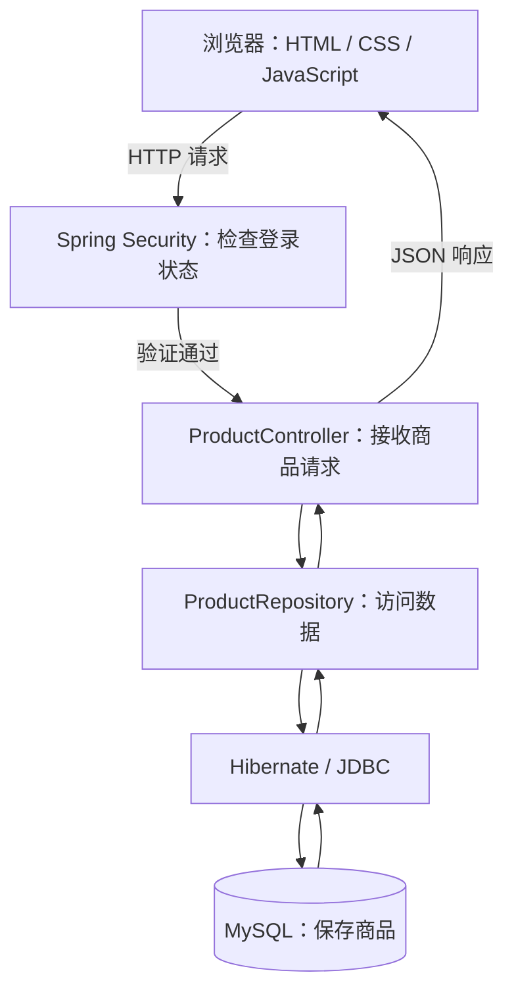

Community 商品管理系统

基于 Spring Boot 的商品管理学习项目，提供商品增删改查、名称搜索、分页列表和基础登录功能。前端使用 HTML、CSS 和原生 JavaScript，由后端统一提供静态页面。

目前为本地开发版本，尚未完成生产部署与完整的角色权限控制。

## 已实现功能

- 商品列表、分页和按名称搜索。
- 新增、编辑、删除商品及销售状态维护。
- 商品名称、价格和库存的后端参数校验。
- Spring Security 表单登录与退出登录。
- 登录后访问商品页面及接口。

## 技术栈

| 模块 | 技术 |
| --- | --- |
| 后端 | Java、Spring Boot、Spring MVC |
| 数据访问 | Spring Data JPA、MySQL |
| 登录认证 | Spring Security、BCrypt、内存用户 |
| 前端 | HTML、CSS、原生 JavaScript、Fetch API |
| 构建 | Maven Wrapper |
| 测试 | JUnit、MockMvc、H2 |

项目包含 Redis 依赖及连接配置；当前商品业务尚未使用 Redis 缓存。

## 系统架构

下面展示已登录用户访问商品接口时的数据流：



登录请求由 Spring Security 单独处理，不经过 ProductController。

## 本地启动

### 1. 准备环境

- 安装 JDK，当前 `pom.xml` 的 Java 编译目标为 17。
- 安装并启动 MySQL，默认连接地址为 `localhost:3306`。
- 首次使用 Maven Wrapper 需要网络下载构建工具与依赖。

依赖的实际版本以仓库中的 `pom.xml` 为准。

### 2. 获取代码

```bash
git clone https://github.com/saber-lab-ux/community.git
cd community
```

### 3. 创建数据库

在 MySQL 客户端执行：

```sql
CREATE DATABASE IF NOT EXISTS community_db
  CHARACTER SET utf8mb4;
```

默认数据库用户名是 `root`。如使用其他账号，可通过环境变量 `SPRING_DATASOURCE_USERNAME` 覆盖。

### 4. 配置密码和建表方式

应用通过环境变量 `DB_PASSWORD` 读取数据库密码。

在 IDEA 的 `CommunityApplication` 运行配置中添加：

| 环境变量 | 值 |
| --- | --- |
| `DB_PASSWORD` | 你本机的数据库密码 |
| `SPRING_JPA_HIBERNATE_DDL_AUTO` | `update` |

项目已通过 `spring.jpa.hibernate.ddl-auto: update` 配置开发环境的自动建表和表结构更新。`update` 仅用于开发数据库。

如果使用 macOS 默认 zsh 终端，可以隐藏输入数据库密码：

```zsh
read -s "DB_PASSWORD?请输入 MySQL 密码："
echo
export DB_PASSWORD
export SPRING_JPA_HIBERNATE_DDL_AUTO=update
./mvnw spring-boot:run
```

也可以在 IDEA 中运行 `CommunityApplication`。终端设置的环境变量不会自动写入 IDEA 的运行配置。

### 5. 打开页面

启动成功后访问：

```text
http://localhost:8081
```

未登录时会进入登录页面。开发演示账号定义在 `SecurityConfig.java`，请查看该文件中的账号配置。不要将这些公开的演示凭据用于线上服务。

新数据库没有商品数据，可登录后通过页面新增商品。

## 项目结构

```text
src/
├── main/
│   ├── java/com/yuxiang/community/
│   │   ├── CommunityApplication.java
│   │   ├── Product.java
│   │   ├── config/SecurityConfig.java
│   │   ├── controller/ProductController.java
│   │   ├── dto/PageResponse.java
│   │   └── repository/ProductRepository.java
│   └── resources/
│       ├── application.yaml
│       └── static/
│           ├── index.html
│           ├── style.css
│           └── app.js
└── test/java/com/yuxiang/community/
```

## 商品接口

以下接口均要求登录，使用表单登录建立的会话访问。

| 方法 | 路径 | 功能 |
| --- | --- | --- |
| GET | `/api/products` | 获取商品列表 |
| GET | `/api/products/{id}` | 查询单个商品 |
| GET | `/api/products/search?name=苹果` | 按名称搜索 |
| GET | `/api/products/page?page=0&size=10&name=` | 分页查询，可附带名称关键词 |
| POST | `/api/products` | 新增商品 |
| PUT | `/api/products/{id}` | 修改商品 |
| DELETE | `/api/products/{id}` | 删除商品 |

分页页码从 `0` 开始，每页数量为 `1–100`，分页结果按商品 ID 降序排列。

新增和修改请求体示例：

```json
{
  "name": "红富士苹果",
  "description": "商品描述",
  "price": 6.20,
  "stock": 100,
  "status": "ON_SALE"
}
```

名称不能为空且最多 120 个字符；价格必须大于 0；库存不能为负数。页面使用 `ON_SALE` 和 `OFF_SALE` 表示销售状态，目前后端尚未限制状态取值范围。

## 测试说明

仓库包含控制器、数据访问及安全配置测试，测试命令为：

```bash
./mvnw test
```

当前部分安全测试仍基于旧的匿名访问规则，需与现有登录配置同步。本 README 整理期间未执行测试，不声明当前全量测试通过。

## 当前限制与后续计划

- 用户保存在内存中，尚未实现注册及数据库用户管理。
- 已声明 ADMIN、USER 角色，尚未按角色限制商品写操作。
- 商品接口暂时排除了 CSRF 校验，后续需要补齐前后端 Token 处理。
- 完善数据库初始化与迁移脚本。商品时间字段当前由数据库负责写入；新建表时还需要完善默认时间和更新时间规则。
- 更新安全测试，补充搜索和分页测试。

GitHub 上传保存的是代码与提交历史，不包含本机 MySQL 数据，也不会自动部署网站。

## 许可证

本项目采用 [MIT License](LICENSE)。
